<div align="center">

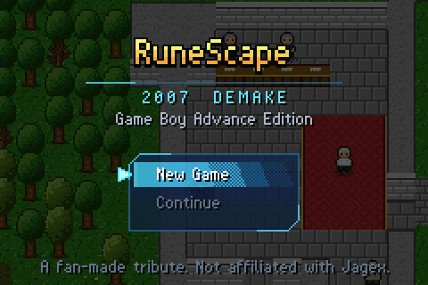

# OSRS GBA Demake

**The 2007 free-to-play RuneScape mainland, rebuilt from scratch for the Game Boy Advance.**

Lumbridge to Varrock, Falador to Al Kharid: skill, quest, fight and bank your way across Gielinor
on a 16.78 MHz handheld, with OSRS-style stone menus, a parchment chatbox and the classic login screen.


[](https://buymeacoffee.com/osrsdave)

[**Download the ROM**](../../releases/latest) · [Features](#features) · [Controls](#controls) · [Quests](#quests) · [Building](#building) · [How it works](#how-it-works)

</div>

---

## Features

### The whole mainland at full scale

The world is one seamless map at OSRS's own scale, one tile per tile: you walk from the fields
into a town and out again with no loading screen or fade. The six towns are rebuilt in detail:
Lumbridge, Varrock, Falador,
Draynor Village, Al Kharid and Edgeville. Their streets, buildings, rooms, doors, fences, trees and
water are traced from the OSRS world map, and each town has its own materials: Lumbridge's grey
stone and red roofs, Varrock's brick and gilded slate around the Square's fountain, Falador's white
stone, lattice fences and flower beds in the park, Draynor's market stalls, Al Kharid's whitewash
and palms, Edgeville's thatch and well. Homes are furnished (beds, tables, chairs, drawers,
bookcases, fireplaces, rugs) and roofs lift off while you are inside.

Lumbridge Castle has all three floors: the kitchen and chequered great hall on the ground floor,
Duke Horacio's bedroom and the spinning wheel on the first, and the bank on the second, linked by the
spiral staircases in the north-west and south-west towers.

Between the towns lies the rest of the free-to-play mainland, 416×416 tiles: the Wizards' Tower,
Port Sarim, Rimmington, Ice Mountain, Barbarian Village, the Wilderness ditch, the Grand Exchange
and the desert. The map is streamed tile by tile as you walk, so the only fades are the castle's
staircases.

<table>
<tr>
<td>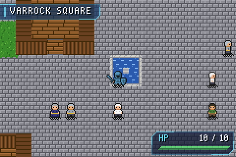</td>
<td>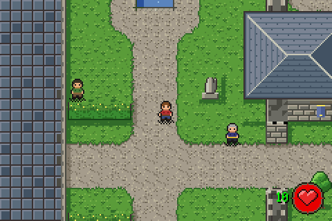</td>
</tr>
<tr>
<td align="center"><sub>Varrock Square and Gypsy Aris's tent</sub></td>
<td align="center"><sub>Lumbridge Castle courtyard</sub></td>
</tr>
<tr>
<td>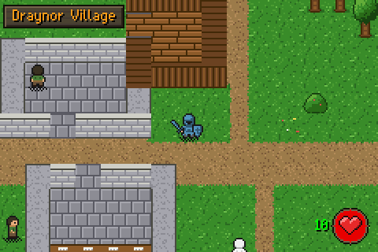</td>
<td>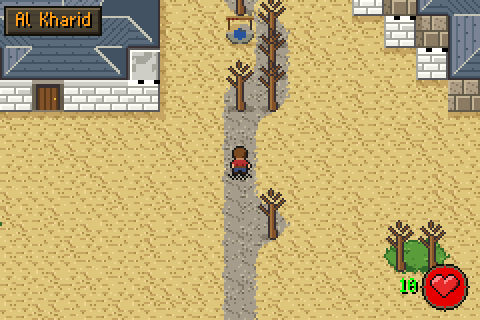</td>
</tr>
<tr>
<td align="center"><sub>Draynor Village market</sub></td>
<td align="center"><sub>Al Kharid</sub></td>
</tr>
<tr>
<td>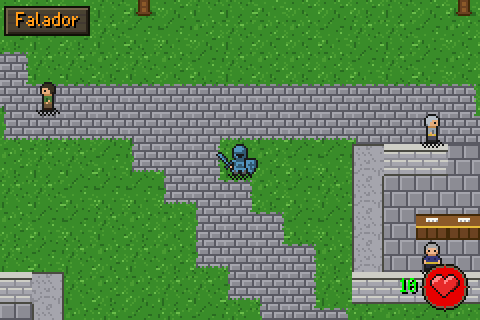</td>
<td>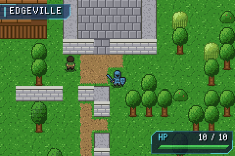</td>
</tr>
<tr>
<td align="center"><sub>Falador Park</sub></td>
<td align="center"><sub>Edgeville</sub></td>
</tr>
<tr>
<td>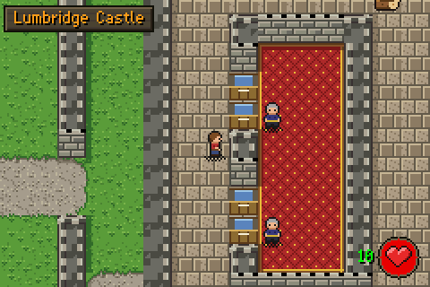</td>
<td>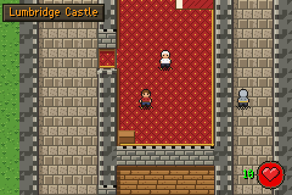</td>
</tr>
<tr>
<td align="center"><sub>The bank on the castle's top floor</sub></td>
<td align="center"><sub>Duke Horacio's room, first floor</sub></td>
</tr>
<tr>
<td>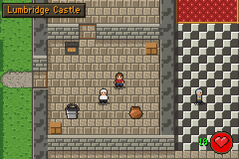</td>
<td>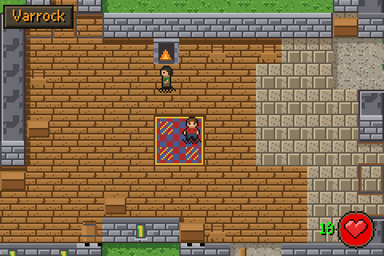</td>
</tr>
<tr>
<td align="center"><sub>The Cook's kitchen</sub></td>
<td align="center"><sub>Inside the Blue Moon Inn</sub></td>
</tr>
</table>

<p align="center">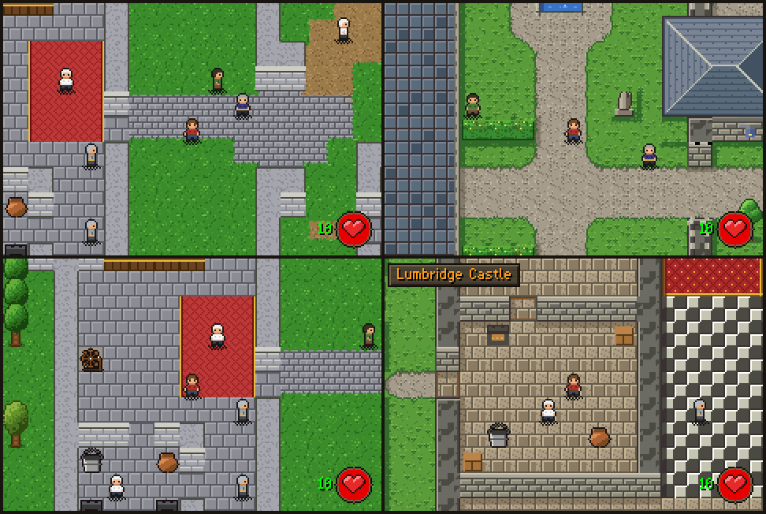<br>
<sub>Lumbridge before (left, 1:2) and after (right, 1:1)</sub></p>

### A menu that stays out of the way

The world screen shows only your HP, the area name, XP drops and messages. Everything else lives
behind **START**, drawn like Old School RuneScape's own interface: brown stone windows with orange
titles and yellow values, a parchment chatbox for dialogue, OSRS level-up messages and quest scrolls,
and the login screen with its flames and music toggle.

<table>
<tr>
<td>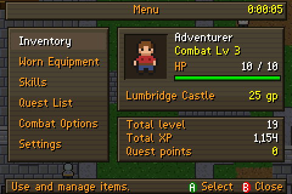</td>
<td>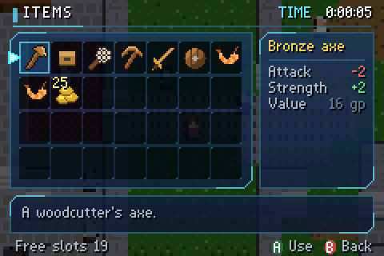</td>
</tr>
<tr>
<td align="center"><sub>Main menu with live character portrait</sub></td>
<td align="center"><sub>28-slot inventory with Use / Eat / Wield / Drop</sub></td>
</tr>
<tr>
<td>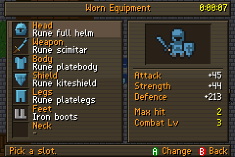</td>
<td>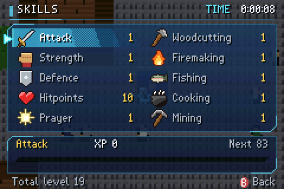</td>
</tr>
<tr>
<td align="center"><sub>Equipment paper-doll with bonus comparison</sub></td>
<td align="center"><sub>Skills with XP to next level</sub></td>
</tr>
</table>

### What you wear is what you see

The player sprite is composited from layers, so every helm, body, legs, boots, shield and weapon
type has its own shape, coloured by metal tier from bronze to rune, in all four directions. You
swing the right axe or pickaxe when skilling, scoop with a net, cast a rod, and stab, slash or crush
depending on your weapon.

<p align="center">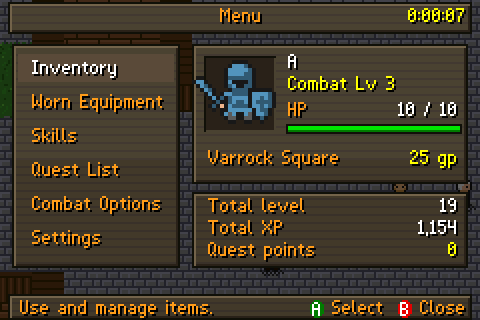</p>

### Quests

13 classic free-to-play quests, driven by a scripted dialogue system with branching choices, a
journal that strikes off finished steps, and an OSRS-style quest-complete scroll.

| Quest | QP | Highlights |
|---|:-:|---|
| Cook's Assistant | 1 | Eggs, the dairy cow, and the windmill hopper |
| The Restless Ghost | 1 | Ghostspeak amulet, the coffin, and the skull at the Wizards' Tower |
| Romeo & Juliet | 5 | Father Lawrence, the Apothecary and cadava berries |
| Sheep Shearer | 1 | Shear sheep and spin wool for Fred |
| Doric's Quest | 1 | Clay, copper and iron for the dwarf north of Falador |
| Rune Mysteries | 1 | Duke Horacio, Sedridor and Aubury |
| Imp Catcher | 1 | Four beads from imps across the map |
| Goblin Diplomacy | 5 | Dye goblin mail for the generals |
| Ernest the Chicken | 4 | Draynor Manor's fountain, compost heap and locked wing |
| Witch's Potion | 1 | Hetty's cauldron in Rimmington |
| Pirate's Treasure | 2 | Redbeard Frank, the Blue Moon Inn chest, and digging in Falador Park |
| Black Knights' Fortress | 3 | Disguise, eavesdrop and sabotage (needs 12 QP) |
| Demon Slayer | 3 | Three keys, Silverlight, and a boss fight against Delrith |

The demake has no Crafting skill, so rewards that originally gave Crafting XP give Firemaking XP.

### And everything you'd expect

- **12 skills** on the real 2007 XP curve to 99: Attack, Strength, Defence, Ranged, Prayer, Magic,
  Hitpoints, Woodcutting, Firemaking, Fishing, Cooking and Mining. XP drops, level-up popups and jingles.
- **Combat** using the 2007 accuracy and max-hit formulas, attack styles, auto-retaliate,
  hitsplats, HP bars, aggressive monsters and loot tables, including a rare mithril/adamant/rune drop.
- **Skilling**: normal, oak, willow and yew trees that turn to stumps and regrow; copper, tin, clay
  and iron rocks; net and fly-fishing spots; fires and ranges with burn chances that fall as you level.
- **Ranged:** shortbows and longbows from normal to maple, bronze to adamant arrows in a new ammo slot
  (the bow decides which arrows it can fire), accurate / rapid / longrange styles, arrows you can pick
  up again under the target, and Lowe's Archery Emporium in Varrock.
- **Magic:** the whole OSRS standard spellbook with its real levels, runes and XP. Every Strike, Bolt,
  Blast, Wave and Surge spell, Crumble Undead, the curses (Confuse to Stun), Bind / Snare / Entangle,
  Monster Inspect, Low and High Level Alchemy and the Lumbridge, Varrock and Falador teleports work
  (Lumbridge Home Teleport has OSRS's 24-tick cast: trace the rune circle, read the book, raise the
  light; walking or combat interrupts it, and it has a 30-minute cooldown);
  spells that need systems the demake doesn't have yet (enchanting, orbs, other teleports, god spells)
  are listed and say so. Autocast with a staff, or cast once from the Spellbook at your target.
  14 runes, staves at Zaff's, runes at Aubury's and Betty's, and dark wizards drop them.
- **Targeting:** L picks the nearest NPC on screen and cycles outwards; the HUD shows its name and level.
  A opens an OSRS-style right-click menu (Attack, Talk-to, Examine), and the target stays picked when
  you walk away, so you can keep shooting or casting from range. B lets it go.
- **Gear** across bronze, iron, steel, mithril, adamant and rune, each item with its own icon.
- **Banks** (96 slots) in every city.
- **Shops stocked like OSRS:** general stores in Lumbridge, Varrock, Falador, Edgeville, Al Kharid and
  Rimmington (pots, buckets, tinderboxes, hammers...) that buy anything, and the specialty shops that sell
  tools and gear: Bob's axes, Gerrant's fishing supplies, Betty's runes and eye of newt, Nurmof's pickaxes,
  Varrock's swords, Horvik's armour, Lowe's bows and arrows, Zaff's staves and Aubury's runes, Peksa's helmets, Cassie's shields, Wayne's chains, Zeke's scimitars and
  Louie's legs. Prices move with stock as in OSRS: general stores sell at 130% of value minus 3% per item
  in stock and pay 40%; specialty shops sell at 100% (2% per item off normal stock) and pay 60% for what
  they stock. Sold-out items come back over time, and anything you sell drains away at one a minute.
- **Music** from a 10-voice software wavetable synth playing a different track in each region,
  plus PSG sound effects.
- **Three characters per cartridge:** New User asks for a display name (up to 12 characters, on an
  on-screen keyboard) and a save slot; Existing User lists the saved characters. Logout from Settings
  saves and returns to the login screen. Saves from v1.0.x move into slot 1 automatically.
- **Hans** in Lumbridge Castle tells you how long you've played, as in OSRS.

---

## Controls

| Button | In the world | In menus |
|---|---|---|
| **D-pad** | Walk (tap to turn on the spot) | Move the cursor |
| **A** | Interact with whatever you face: chop, mine, fish, attack, talk, cook, bank, pick up. With a target picked (and no one else in front of you), open its menu: Attack, Talk-to, Examine | Select |
| **B** | Hold to run; tap to stop what you're doing and let go of the target | Back |
| **START** | Open the menu (the game pauses) | Close the menu |
| **L** | Pick a target: the nearest NPC on screen, then the next one out on each press | Switch tabs in the bank and shops |
| **R** | | Switch tabs in the bank and shops |
| **SELECT** | | Deposit your whole inventory at a bank |

In mGBA's default keyboard layout, A is **X**, B is **Z**, START is **Enter**, SELECT is
**Backspace** and L / R are **A / S**.

---

## Playing

1. Download `osrs-gba-demake.gba` from the [latest release](../../releases/latest).
2. Open it in any Game Boy Advance emulator. [mGBA](https://mgba.io) is recommended, and Delta
   works well on iPhone.
3. Saves use 32 KB of SRAM and are created next to the ROM.

The ROM's header is patched with `gbafix`, so it is also ready for flash carts and real hardware
(only tested in emulators so far).

---

## Building

The game is plain C and ARM assembly for a bare-metal GBA. You only need the Arm GNU Toolchain
(`arm-none-eabi-gcc`) and Python 3; devkitPro and libtonc are not used.

```bash
./build.sh
```

`build.sh` uses a toolchain in `.toolchain/` if one is there, otherwise `arm-none-eabi-gcc` on your
`PATH`. All art, the map, the quests, the font and the music data are generated from source by
Python scripts in `tools/` at build time.

To fetch the toolchain locally (macOS, Apple silicon):

```bash
mkdir -p .toolchain && curl -L https://developer.arm.com/-/media/Files/downloads/gnu/15.2.rel1/binrel/arm-gnu-toolchain-15.2.rel1-darwin-arm64-arm-none-eabi.tar.xz | tar xJ -C .toolchain
```

For flash carts and real hardware, the build also runs devkitPro's `gbafix` when it is on your
`PATH` or in `.toolchain/`:

```bash
curl -L https://raw.githubusercontent.com/devkitPro/gba-tools/master/src/gbafix.c -o .toolchain/gbafix.c
cc -O2 .toolchain/gbafix.c -o .toolchain/gbafix
```

### Using your own music

The repository ships original placeholder tunes. To build with your own MIDI files, put them in
`music/local/` with a `music/local/tracks.txt` in the same format as
[`music/tracks.txt`](music/tracks.txt). That folder is ignored by git, and the build picks it up
automatically. See [`music/SOURCES.md`](music/SOURCES.md).

### Automated testing

`tools/harness.c` runs the ROM headlessly through libmgba, feeds it scripted input and writes PNG
screenshots and WAV audio. Scenario scripts can teleport the player and edit game state using
`@symbol` addresses from the linker map.

```bash
tools/build_mgba.sh             # download and build libmgba 0.10.5 into .toolchain/ (needs cmake)
tools/build_harness.sh          # build the harness against it
make test                       # plays all 13 quests end to end, bank/shop/skilling/combat tests, save/reload
python3 tools/snap.py build/snap_after --compare build/snap_before   # screenshot regression check
```

GitHub Actions builds the ROM and runs the test suite on every pull request and push to `main`, and
uploads the ROM as a build artifact. Pushing a `v*` tag builds, tests and attaches
`osrs-gba-demake.gba` to that tag's release (a draft is created if the release doesn't exist yet).

---

## How it works

| Piece | What it does |
|---|---|
| **One world** | The mainland is a single 416×416-cell map (one cell per OSRS tile), with the castle's upper floors placed below it in the same grid, so collision, NPCs, items and quests need no special cases. Nine of the fourteen world palette banks are shared by every town; the rest hold a town's own materials and are swapped while the camera approaches it, before any of its tiles come into view. |
| **World streaming** | The map stays in ROM. A reference-counted cache of 576 VRAM tiles is updated one row or column at a time as the camera moves, so the whole mainland fits in video memory with no seams. Stumps and depleted rocks live in a small override table. |
| **UI canvases** | Two background layers give every screen cell its own tile. Panels and proportional text are drawn per pixel into RAM and streamed to VRAM. A per-scanline HBlank DMA paints the panel gradient, and hardware alpha blending fades the windows in and out. |
| **Avatar compositing** | 137 layer graphics (bodies, armour, shields, weapons, tools) are stacked into a 32×32 sprite whenever your gear or pose changes, then recoloured by metal tier through the palette. |
| **Quest scripts** | Quests are written in a small script language (`tools/quests.txt`) and compiled to bytecode at build time, with checks on dialogue fit, labels and reachability. A tiny VM runs them in game. |
| **Music** | MIDI files are converted at build time. A 10-voice wavetable synth written in ARM assembly runs from IWRAM and mixes 13.4 kHz audio into DirectSound through DMA, using about 17% of each frame. |

### Project layout

| Path | Purpose |
|---|---|
| `src/crt0.s`, `src/gba.ld` | Cartridge header, startup and IRQ handler |
| `src/gfx.c` | VRAM layout, palettes, fades, tile streaming and OAM |
| `src/canvas.c` | UI drawing: font, panels, bars and highlights |
| `src/world.c` | Map state, movement, NPC AI, ground items, fires and the game tick |
| `src/combat.c`, `src/skilling.c` | Melee, ranged and magic attacks, projectiles and drops; woodcutting, mining, fishing, firemaking, cooking and the A-button interact |
| `src/spells.c`, `src/target.c` | The standard spellbook and its effects; L targeting and the target menu |
| `src/world_draw.c` | Depth-sorted world sprites |
| `src/ui.c` | UI core: shared helpers, popups, item grid, menu chrome |
| `src/hud.c`, `src/menu.c`, `src/dialog.c` | HUD and level-ups, START menu and quest journal, the chatbox |
| `src/store.c`, `src/title.c` | Bank and shop screens, the login screen |
| `src/shops.c` | Shop stock lists, OSRS pricing, restocking |
| `src/quests.c` | Quest script VM, journal and rewards |
| `src/avatar.c` | Composited player sprite |
| `src/sound.c`, `src/mixer.s` | Music synth and sequencer, sound effects |
| `src/data.c`, `src/save.c` | Item and NPC tables, SRAM save |
| `tools/world_gen.py` | The world map in OSRS coordinates, the 1:1 zones, tiles and palettes |
| `tools/hd_art.py` | Terrain, building, roof and furniture art for the 1:1 towns |
| `tools/zones/` | Each town's traced layout (`*.ref`) and its banks, shops and landmarks (`*.py`) |
| `tools/ref_extract.py` | Traces an OSRS world-map area into a `.ref` layout (only needed to re-trace a town) |
| `tools/gen_assets.py`, `tools/gen_avatar.py` | Sprites, icons, font and avatar layers |
| `tools/quests.txt`, `tools/gen_quests.py` | Quest scripts and their compiler |
| `tools/midi2gba.py`, `music/` | MIDI converter, instrument bank and tracks |

---

## Known limitations

- Dragon Slayer and members' content are not included.
- The Wilderness has scenery but no monsters yet, and some OSRS shops (runes, food, archery, clothes) are not in yet. Shops only stock items the demake has (no battleaxes, black or adamant weapons, harpoons, lobster pots or bait).
- There is no coal, and the Duel Arena is cut off by the map's east edge. The Al Kharid toll is always charged (no Prince Ali Rescue yet).
- The synth plays up to 10 notes at once and ignores pitch bends.
- Standing directly north of a tree hides your character behind its leaves.
- Walls take a whole tile in the 1:1 towns where OSRS draws them on tile edges, so rooms are a
  tile smaller on each side, and interiors are furnished from typical OSRS homes rather than
  object by object. Only Lumbridge Castle has upper floors so far.

## Support

If you enjoy the demake, you can [buy me a coffee](https://buymeacoffee.com/osrsdave).

## Disclaimer

This is a non-commercial fan project made for fun. It is not affiliated with, endorsed by or
connected to Jagex Ltd. RuneScape and Old School RuneScape are trademarks of Jagex Ltd. All art in
this repository is generated procedurally, and the bundled music consists of original compositions.
The 1:1 town layouts are traced from the [OSRS Wiki](https://oldschool.runescape.wiki) world map.
